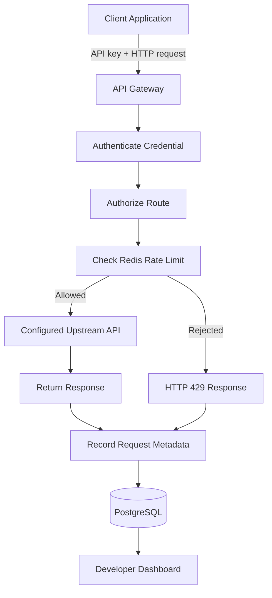

# API Gateway Platform

**A TypeScript API gateway for request routing, API-key authentication, rate limiting, and usage analytics.**

[](https://www.typescriptlang.org/)
[](https://nodejs.org/)
[](https://redis.io/)
[](https://www.postgresql.org/)

> **Project status:** In development. Feature availability, deployment links, and performance results will be updated as the implementation progresses.

## Overview

API Gateway Platform is a developer-focused API gateway that provides a controlled entry point between client applications and backend services.

It centralizes API-key authentication, request routing, rate limiting, and request analytics so developers can manage API access and understand how their services are being used.

The project is designed as a practical exploration of production-oriented backend engineering, distributed rate limiting, API security, and full-stack product development.

## The Problem

As applications grow, backend teams often need consistent ways to:

- Authenticate API consumers.
- Prevent excessive or abusive request traffic.
- Route requests to the correct backend service.
- Monitor request failures and latency.
- Track API usage across developers and applications.
- Investigate errors without manually inspecting every service.

Implementing these controls independently across multiple services can lead to duplicated logic and inconsistent behavior.

## The Solution

API Gateway Platform provides a centralized layer that validates requests before forwarding them to configured upstream services.

A developer sends a request using an API key. The gateway authenticates the credential, checks permissions and rate limits, forwards authorized traffic, and records request metadata for analysis.

The dashboard provides a user interface for managing credentials, inspecting requests, and understanding usage.

## Key Features

### API access management
- Generate API credentials using cryptographically secure randomness.
- Associate credentials with developer accounts.
- Revoke credentials and configure expiration.
- Store credential hashes rather than plaintext secrets.

### Request routing
- Route requests to explicitly configured upstream services.
- Forward supported HTTP methods and paths.
- Apply upstream connection and response timeouts.
- Return consistent error responses.

### Rate limiting
- Apply configurable per-key request limits.
- Use Redis for shared rate-limit state.
- Reject excess requests with HTTP 429.
- Return useful rate-limit and retry headers.

### Request analytics
- Record request IDs, routes, response status codes, and latency.
- Inspect recent requests through the dashboard.
- Identify error rates and frequently accessed routes.
- Aggregate usage for reporting.

### Developer dashboard
- Manage API credentials.
- Inspect configured routes.
- View request activity and usage summaries.
- Access example API requests and documentation.

> Features listed above describe the intended scope. Each feature should be marked as implemented only after it has been built and tested.

## How It Works



### Request lifecycle

1. A client sends an HTTP request with an API key.
2. The gateway validates the credential.
3. The gateway checks whether the client can access the requested route.
4. Redis-backed rate limiting determines whether the request is permitted.
5. Authorized requests are forwarded to the configured upstream service.
6. The gateway returns the upstream response or a controlled error.
7. Request metadata is recorded for usage analytics.

## Technology Stack

| Layer | Technology | Responsibility |
|---|---|---|
| Dashboard | Next.js, React, TypeScript | Developer interface |
| Gateway | Node.js, Fastify, TypeScript | Authentication, routing, request handling |
| Database | PostgreSQL | Persistent configuration and usage records |
| ORM | Drizzle ORM | Database queries and migrations |
| Rate limiting | Redis | Shared counters and rate-limit state |
| Validation | Zod | Runtime validation of inputs and configuration |
| Testing | Vitest, Playwright | Unit, integration, and browser tests |
| Infrastructure | Docker, Docker Compose | Local development environment |
| CI/CD | GitHub Actions | Automated quality checks |
| Observability | Pino; OpenTelemetry planned | Structured logs and service instrumentation |

## Architecture

The repository uses a monorepo structure so applications and shared packages can be developed together.

```text
api-gateway-platform/
├── apps/
│   ├── dashboard/       # Next.js developer dashboard
│   ├── gateway/         # Fastify API gateway
│   └── demo-api/        # Example upstream service
├── packages/
│   ├── shared-types/    # Shared TypeScript types
│   └── config/          # Shared configuration
├── docs/
│   ├── architecture.md
│   ├── security.md
│   └── api-reference.md
├── docker-compose.yml
├── pnpm-workspace.yaml
├── turbo.json
└── README.md
```

Turborepo coordinates builds, tests, and other tasks across the workspace. pnpm manages dependencies.

The gateway is initially designed as a modular application rather than a collection of independently deployed microservices.

## Getting Started

### Prerequisites

Install the following tools:

- Node.js — use a supported LTS release.
- pnpm — package manager.
- Docker Engine and Docker Compose.
- Git.

### Installation

Clone the repository:

```bash
git clone <YOUR_GITHUB_REPOSITORY_URL>
cd api-gateway-platform
```

Install dependencies:

```bash
pnpm install
```

Create your local environment file using the provided example:

```bash
cp .env.example .env
```

Configure the required environment variables. Do not commit real secrets to Git.

Start the local infrastructure:

```bash
docker compose up -d
```

Run database migrations using the project's documented migration command, then start the development applications:

```bash
pnpm dev
```

> The commands above are the intended developer workflow. They should be kept in sync with the actual workspace scripts and Docker Compose configuration.

## Example API Usage

Once the gateway and demo API are running, create an API key through the dashboard.

Example request:

```bash
curl -i \
  -H "X-API-Key: YOUR_API_KEY" \
  http://localhost:3001/v1/products
```

A successful request should return the response configured by the demo upstream API.

An invalid API key should return `401 Unauthorized`. A request exceeding its rate limit should return `429 Too Many Requests`.

The actual endpoint and port should match the implementation.

## Example Rate-Limit Response

```http
HTTP/1.1 429 Too Many Requests
Content-Type: application/json
Retry-After: 12
```

```json
{
  "error": {
    "code": "RATE_LIMIT_EXCEEDED",
    "message": "Request limit exceeded. Retry later."
  }
}
```

The retry value is illustrative; the implementation should calculate it from the active rate-limit policy.

## Security Considerations

Security is a core design requirement, not a feature to add at the end.

The implementation should address:

- Secure API-key generation, storage, and revocation.
- Server-side authorization and route-level permissions.
- Atomic rate limiting across gateway instances.
- Request-size limits and upstream timeouts.
- Strict validation of upstream destinations to prevent SSRF.
- Protection of internal network addresses and cloud metadata endpoints.
- Safe handling of redirects and upstream errors.
- Secret redaction in logs.
- Dependency auditing and automated security checks.
- Appropriate retention and access controls for usage data.

The gateway should only forward requests to explicitly configured, permitted upstream services. It should not act as an unrestricted proxy for arbitrary URLs.

## Testing Strategy

The project should include:

- **Unit tests:** API-key validation, policy evaluation, and rate-limit logic.
- **Integration tests:** PostgreSQL persistence, Redis behavior, and upstream proxying.
- **Security tests:** Invalid credentials, revoked keys, unauthorized routes, and prohibited destinations.
- **Concurrency tests:** Simultaneous requests at rate-limit boundaries.
- **Failure tests:** Redis errors, upstream timeouts, and unavailable services.
- **End-to-end tests:** Complete workflows through the dashboard.
- **Load tests:** Throughput, latency percentiles, and error rates under documented conditions.

Performance claims will be published only after reproducible benchmarks have been run.

## Development Roadmap

- [ ] Initialize the monorepo and local infrastructure.
- [ ] Implement API-key creation, validation, and revocation.
- [ ] Add Redis-backed rate limiting.
- [ ] Implement configured upstream routing.
- [ ] Record request metadata and build usage analytics.
- [ ] Build the developer dashboard.
- [ ] Add automated tests and CI security checks.
- [ ] Deploy a working demonstration.
- [ ] Add plan-level quotas and richer analytics.
- [ ] Add OpenTelemetry instrumentation and load-test reports.
- [ ] Evaluate a small TypeScript client SDK.

## Design Decisions

The initial implementation prioritizes:

- A small number of understandable services.
- Explicit routing and restrictive security defaults.
- PostgreSQL for durable data and Redis for fast shared counters.
- Automated tests around failure behavior.
- Measurable performance rather than unsupported speed claims.
- Clear separation between the gateway and the dashboard.

## Current Limitations

This project is an educational and portfolio implementation, not a claim of production equivalence to mature commercial API gateway products.

Before production use, additional work may be required for high availability, distributed failure handling, multi-region operation, key rotation, abuse prevention, observability, and operational recovery.

## Documentation

- [Architecture](docs/architecture.md)
- [Security Model](docs/security.md)
- [API Reference](docs/api-reference.md)

Documentation links will become available as these files are created.

## License

The project license has not yet been selected. Add a `LICENSE` file before presenting the repository as open source, and make sure the chosen license matches your intended distribution and reuse terms.
